

# Perezeando

**El mapa interactivo de Costa Rica: volcanes, playas, fauna, cultura y comida típica en un solo lugar.**

 
 

 
 

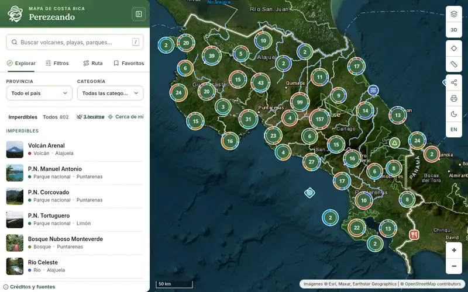

Búsqueda → vuelo al lugar → ficha con foto, datos y lugares cercanos.

 

**Perezeando** reúne en un mapa los volcanes, parques nacionales, cataratas, playas, fauna, ciudades, sitios históricos, comida típica, deporte y mar territorial de Costa Rica. Cada lugar tiene su ficha, con foto, créditos y enlaces a las fuentes.

> [!NOTE]
> Atlas de consulta: no es un sitio oficial ni administra los lugares que muestra. Las distancias y los tiempos de ruta son estimaciones.

---

## ✨ Lo destacado

<table>
  <tr>
    <td width="50%" valign="top">
      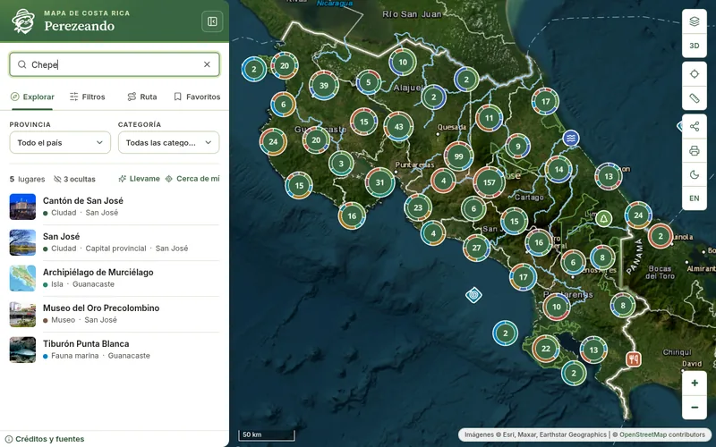
      <h3>🔎 Búsqueda con apodos</h3>
      «Chepe» encuentra San José y «La Ciudad de las Flores», Heredia. También busca por gentilicio, categoría y nombre en inglés.
    </td>
    <td width="50%" valign="top">
      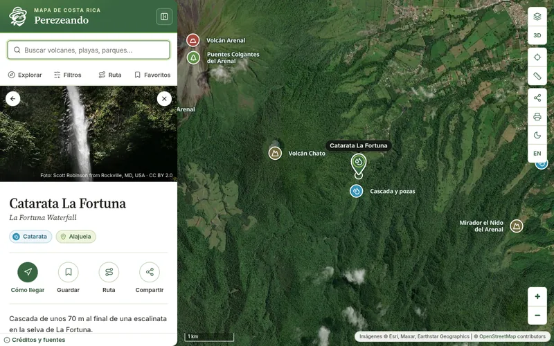
      <h3>📍 Fichas completas</h3>
      Foto con autor y licencia, datos del lugar, extracto de Wikipedia y los lugares más cercanos, sin salir de la ficha.
    </td>
  </tr>
  <tr>
    <td width="50%" valign="top">
      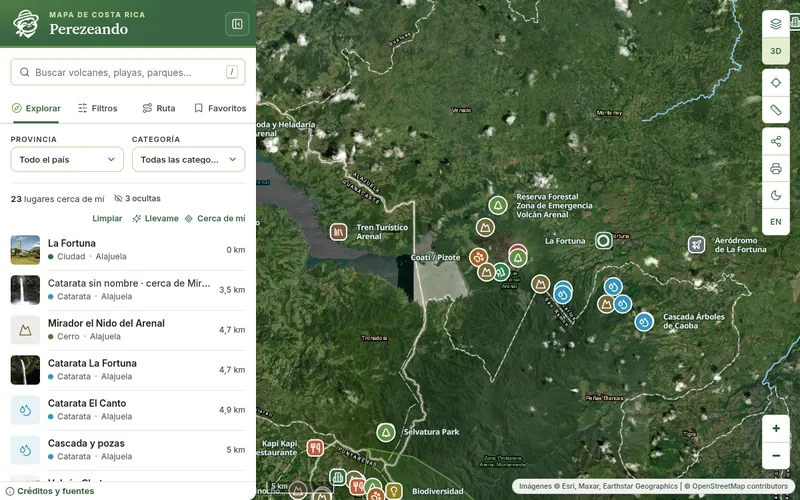
      <h3>🧭 Cerca de mí</h3>
      Lugares en un radio de 25 km (50 km si hay pocos), ordenados por distancia. La ubicación no se envía a ningún servidor.
    </td>
    <td width="50%" valign="top">
      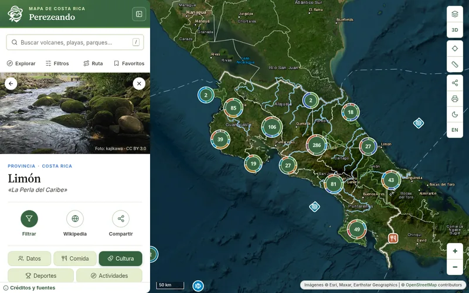
      <h3>🏞️ Cada provincia, a fondo</h3>
      Cinco pestañas por provincia: Datos, Comida, Cultura, Deportes y Actividades.
    </td>
  </tr>
</table>

---

## 🧭 Qué se puede hacer

<table>
  <tr>
    <td width="50%">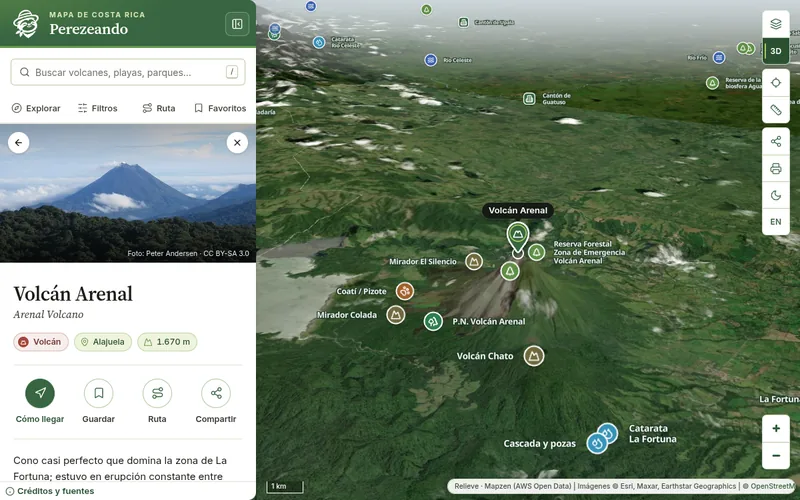</td>
    <td width="50%" valign="top">
      <h3>🗺️ Explorar</h3>
      <ul>
        <li>835 lugares que se agrupan al alejar el mapa.</li>
        <li>Cuatro mapas base: satélite, calles, relieve y oscuro.</li>
        <li>Vista 3D del terreno y relieve sombreado.</li>
        <li>Límites provinciales, zona económica exclusiva y una regla para medir distancias.</li>
      </ul>
    </td>
  </tr>
  <tr>
    <td width="50%" valign="top">
      <h3>🐾 Descubrir</h3>
      <ul>
        <li>59 especies: 39 terrestres y 20 marinas, con dónde verlas y cómo cuidarlas.</li>
        <li>25 categorías en 7 grupos, de volcanes a comida típica.</li>
        <li>«Imperdibles» para empezar y «Llevame» para abrir un lugar al azar.</li>
      </ul>
    </td>
    <td width="50%">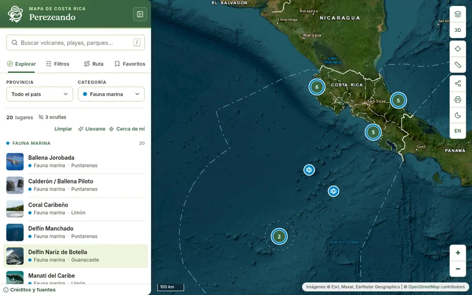</td>
  </tr>
  <tr>
    <td width="50%">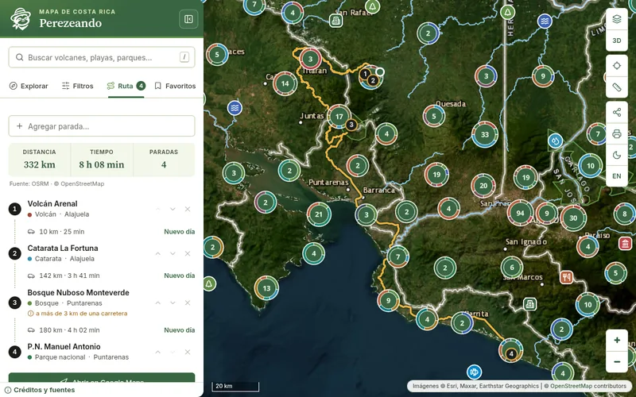</td>
    <td width="50%" valign="top">
      <h3>🚗 Planear</h3>
      <ul>
        <li>Rutas en carro con varias paradas, distancia y tiempo.</li>
        <li>Orden optimizado y división por días, con pueblo para dormir.</li>
        <li>Exportación a GPX y apertura en Google Maps.</li>
        <li>Favoritos guardados en el navegador, sin cuentas.</li>
      </ul>
    </td>
  </tr>
  <tr>
    <td width="50%" valign="top">
      <h3>📶 Siempre disponible</h3>
      <ul>
        <li>Se instala como app y abre sin conexión después de la primera visita.</li>
        <li>Modo oscuro, español e inglés.</li>
        <li>Enlaces con vista previa (título, descripción y foto) en WhatsApp, Telegram, X y Facebook.</li>
        <li>Impresión del mapa con leyenda y fuentes.</li>
      </ul>
    </td>
    <td width="50%">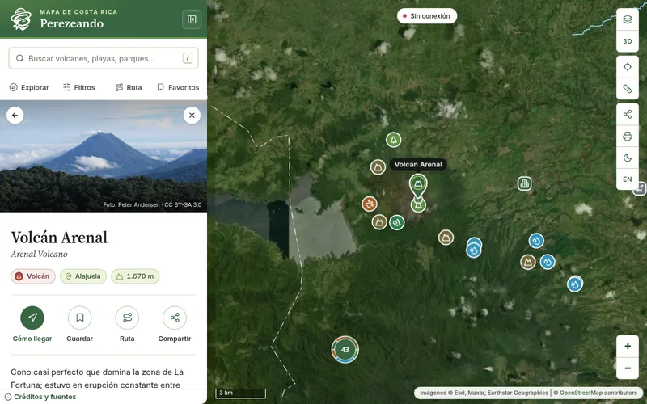</td>
  </tr>
</table>

---

## 📱 Escritorio y móvil

<table>
  <tr>
    <td width="72%" align="center">
      <picture>
        <source media="(prefers-color-scheme: dark)" srcset="./docs/img/cmp-desktop-dark.webp" />
        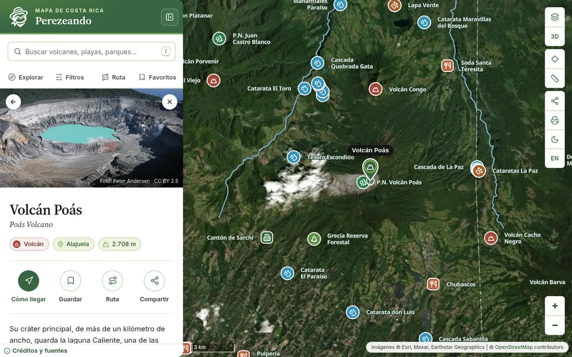
      </picture>
    </td>
    <td width="28%" align="center">
      <picture>
        <source media="(prefers-color-scheme: dark)" srcset="./docs/img/cmp-mobile-dark.webp" />
        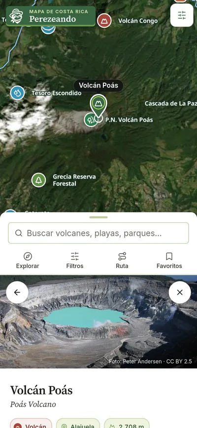
      </picture>
    </td>
  </tr>
</table>

Las capturas siguen el tema de GitHub: claro o modo oscuro.

---

## 📊 En números

| **835** |      **59**       |          **495**           |        **476**         |         **7 + mar**          |
| :-----: | :---------------: | :------------------------: | :--------------------: | :--------------------------: |
| lugares | especies de fauna | fotos con autor y licencia | artículos de Wikipedia | provincias y mar territorial |

---

## ⚡ Rendimiento

| Mapa listo     | Escritorio | Móvil |
| :------------- | :--------: | :---: |
| Primera visita |   4,6 s    | 6,0 s |
| Segunda visita |   1,9 s    | 1,3 s |
| Sin conexión   |   1,2 s    | 0,8 s |

Build de producción con red Fast 3G y CPU 4× más lenta, mediana de 3 corridas (noviembre de 2026). ~133 kB de JavaScript inicial (gzip); el motor del mapa y los paneles se cargan cuando se necesitan.

---

## 📚 Fuentes y licencias

- **Mapas:** © colaboradores de OpenStreetMap (ODbL), Esri y OpenTopoMap (CC BY-SA).
- **Límites provinciales:** geoBoundaries (ODbL).
- **Relieve y 3D:** Mapzen Terrain Tiles (AWS Open Data).
- **Rutas:** OSRM, sobre datos de OpenStreetMap.
- **Textos y fotos:** Wikipedia y Wikimedia Commons, con el autor y la licencia de cada uno en la ficha.

El sitio incluye las páginas **Créditos y fuentes** y **Políticas de uso y derechos de autor**.

---

## 🛠️ Hecho con

---

## 📄 Licencia

El código está bajo licencia [MIT](./LICENSE) © 2026 Ponss17.

La licencia MIT no cubre las fotos, los textos ni los datos de mapas. Cada uno conserva la licencia de su fuente: CC BY-SA en los textos de Wikipedia y en OpenTopoMap; ODbL en OpenStreetMap y geoBoundaries; la licencia que indica cada foto (en su mayoría CC BY, CC BY-SA, CC0 o dominio público, de Wikimedia Commons); y los términos de Esri en sus mapas base. El autor y la licencia aparecen en cada ficha y en **Créditos y fuentes**.

---

**Hecho en Costa Rica 🇨🇷**

<a href="https://perezeando.lospherris.workers.dev">perezeando.lospherris.workers.dev</a>

